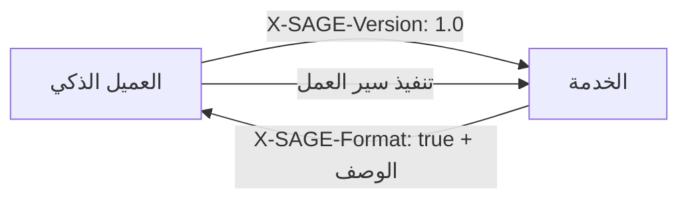

# بروتوكول SAGE

**محرك بوابة الخادم-العميل الذكي (Server-Agent Gateway Engine)** — بروتوكول وصف واجهة موجه للخدمة للعملاء الذكيين المستقلين أو شبه المستقلين.

[English](README.en.md) · [中文](README.md) · [Español](README.es.md) · [Русский](README.ru.md)

---

## ما هو SAGE؟

عندما يكتشف الخادم أن طلباً صدر عن عميل ذكي (Agent)، يمكنه إرجاع **وثيقة وصف SAGE** التي تصف سير العمل المتاح، وطرق تسجيل الدخول، وقيود المعلمات، وحدود التنفيذ. يقوم العميل الذكي بتحليل الوصف، واختيار سير العمل، وطلب تفويض المستخدم عند الحاجة، واستدعاء واجهات برمجة التطبيقات الحالية للخدمة.

SAGE **لا يحل محل** HTTP أو REST أو GraphQL أو OpenAPI أو MCP. بل يضيف **طبقة وصف سير العمل على مستوى الخدمة** التي تجعل الخدمات الحالية أكثر قابلية للاستخدام من قبل العملاء الذكيين.



## الميزات الرئيسية

- **مبني على Markdown** — وثائق الوصف قابلة للقراءة من البشر
- **تبني تدريجي** — تضيف الخدمات SAGE عند نقطة الدخول دون إعادة كتابة API
- **موجه لسير العمل** — يصف العمليات التجارية وليس فقط نقاط النهاية API
- **تفويض المستخدم** — حدود واضحة للعمليات الحساسة
- **الخصوصية أولاً** — مفاتيح عميل ذكي لكل خدمة، بدون تتبع بين الخدمات
- **متعدد اللغات** — وثائق الوصف تعمل بأي لغة بشرية

## هيكل المستودع

```
sage-protocol/
├── README.md              # 中文（默认）
├── README.en.md           # English
├── README.es.md           # Español
├── README.ar.md           # هذا الملف
├── README.ru.md           # Русский
├── spec/
│   ├── sage-protocol-v1.0-draft-02-en.md
│   ├── sage-protocol-v1.0-draft-02-zh.md
│   ├── sage-protocol-v1.0-draft-02-es.md
│   ├── sage-protocol-v1.0-draft-02-ar.md
│   └── sage-protocol-v1.0-draft-02-ru.md
├── skill/
│   ├── sage-skill-v1.0.0-en.md     # Skill (English)
│   ├── sage-skill-v1.0.0-zh.md     # Skill (中文)
│   ├── sage-skill-v1.0.0-es.md     # Skill (Español)
│   ├── sage-skill-v1.0.0-ar.md     # Skill (العربية)
│   └── sage-skill-v1.0.0-ru.md     # Skill (Русский)
└── LICENSE
```

## البدء السريع

### لمزودي الخدمات

1. اقرأ [المواصفات](spec/sage-protocol-v1.0-draft-02-ar.md)
2. اكتشف `X-SAGE-Version` في الطلبات الواردة
3. أعد وثيقة وصف SAGE مع ترويسة `X-SAGE-Format: true`
4. واجهات برمجة التطبيقات الحالية تبقى كما هي

### لمطوري العملاء الذكيين (عميل أصلي)

1. اقرأ [المواصفات](spec/sage-protocol-v1.0-draft-02-ar.md)
2. أرسل ترويسات `X-SAGE-Version` و `X-Agent-Public-Key`
3. حلل وثيقة الوصف المُعادة
4. نفذ سير العمل بتفويض المستخدم

### لمطوري العملاء الذكيين (مبني على المهارة)

إذا لم تكن بيئة تشغيل العميل الذكي تدعم SAGE بشكل أصلي:

1. انسخ ملف [المهارة](skill/sage-skill-v1.0.0-ar.md) إلى آلية المهارة/التعليمات الخاصة بعميلك الذكي
2. تعلم المهارة عميلك الذكي كيفية اكتشاف وتحليل وتنفيذ تفاعلات SAGE
3. يعمل مع أي عميل ذكي مبني على LLM يدعم استدعاء الأدوات أو الوصول إلى HTTP

## مثال: وثيقة وصف SAGE

```markdown
# خدمة حجز الفنادق في طوكيو

## ملاحظات عامة
هل يتطلب تسجيل الدخول: لا
- جميع الحجوزات تتطلب تأكيد نهائي من المستخدم.

## طرق تسجيل الدخول

## الحجز مع إعطاء الأولوية للميزانية
استخدم هذا السير عندما يعطي المستخدم الأولوية للسعر.

### الخطوة 1
url: GET /hotels/search
params:
- city: string (required)
- sort: string (required, fixed=price)
- min_rating: float (optional, min=0, max=5, default=4.0)
prompt: اختر ثلاثة فنادق منخفضة السعر بتقييمات مقبولة.

### الخطوة 2
url: GET /hotels/availability
params:
- hotel_id: int (required)
- date: string (required, format=YYYY-MM-DD)
prompt: إذا لم يكن متاحاً، اطلب من المستخدم التعديل.

### الخطوة 3
url: POST /bookings
params:
- hotel_id: int (required)
- check_in: string (required, format=YYYY-MM-DD)
- check_out: string (required, format=YYYY-MM-DD)
- guest_name: string (required)
prompt: اعرض الملخص واحصل على تأكيد صريح من المستخدم قبل الحجز.
```

## العلاقة بالبروتوكولات الأخرى

| البروتوكول | الوحدة الأساسية | السؤال المُجاب عليه |
|------------|----------------|---------------------|
| **OpenAPI** | نقطة نهاية API | ما المعلمات التي تقبلها هذه النقطة؟ |
| **MCP** | أداة/مورد | ما الأدوات المتاحة للعميل الذكي؟ |
| **SAGE** | سير عمل الخدمة | كيف يجب أن يستخدم العميل الذكي هذه الخدمة لإتمام مهمة المستخدم؟ |

## مستويات المطابقة

### عميل SAGE

| المستوى | المتطلبات |
|---------|-----------|
| **الحد الأدنى** | إرسال `X-SAGE-Version`، اكتشاف `X-SAGE-Format`، تحليل الترويسات، فرض تفويض المستخدم |
| **المعيار** | + تحليل جميع الحقول، التحقق من المعلمات، إعادة استخدام الرموز، سياق التنفيذ |
| **المتقدم** | + تحليل متعدد اللغات، سجلات المراجعة، ضوابط السياسة، القابلية للتفسير |

### خادم SAGE

| المستوى | المتطلبات |
|---------|-----------|
| **الحد الأدنى** | اكتشاف `X-SAGE-Version`، إرجاع `X-SAGE-Format`، وثيقة وصف صالحة |
| **المعيار** | + إصدار الخادم، إصدار الرموز، طرق تسجيل الدخول، أخطاء منظمة |
| **المتقدم** | + تكييف القدرات، تدوير الرموز، أوصاف محلية، تشغيل تجريبي |

## المساهمة

هذه مواصفات تجريبية. نرحب بالتعليقات والمشكلات وطلبات السحب.

## المؤلف

**段诗闻** (Shiwen Duan)  
البريد الإلكتروني: yakii9@vip.qq.com

## الترخيص

[CC BY 4.0](https://creativecommons.org/licenses/by/4.0/) — أنت حر في مشاركة وتعديل هذا материал، مع الإشارة إلى المصدر.
