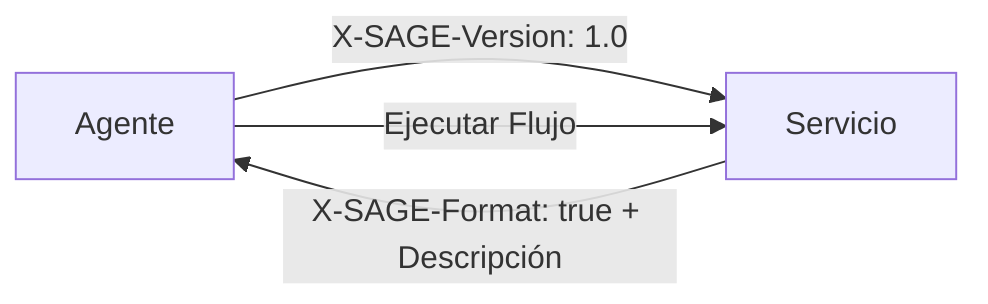

# SAGE Protocol

**Server-Agent Gateway Engine** — Un protocolo de descripción de interfaz orientado al servicio para agentes de software autónomos o semiautónomos.

[English](README.en.md) · [中文](README.md) · [العربية](README.ar.md) · [Русский](README.ru.md)

---

## ¿Qué es SAGE?

Cuando un servidor detecta que una solicitud proviene de un Agente, puede devolver un **Documento de Descripción SAGE** que describe los flujos de trabajo disponibles, métodos de inicio de sesión, restricciones de parámetros y límites de ejecución. El Agente interpreta la descripción, selecciona un flujo de trabajo, solicita autorización del usuario cuando es necesario e invoca las API existentes del servicio.

SAGE **no reemplaza** HTTP, REST, GraphQL, OpenAPI ni MCP. Añade una **capa de descripción de flujos de trabajo a nivel de servicio** que hace que los servicios existentes sean más utilizables por los Agentes.



## Características Clave

- **Basado en Markdown** — Los documentos de descripción son Markdown legible por humanos
- **Adopción incremental** — Los servicios añaden SAGE en el punto de entrada, sin reescritura de API
- **Orientado a flujos de trabajo** — Describe procesos de negocio, no solo endpoints de API
- **Autorización del usuario** — Límites explícitos para operaciones sensibles
- **Privacidad primero** — Claves de Agente por servicio, sin rastreo entre servicios
- **Multilenguaje** — Los documentos de descripción funcionan en cualquier idioma

## Estructura del Repositorio

```
sage-protocol/
├── README.md              # English
├── README.zh-CN.md        # 中文
├── README.es.md           # Este archivo
├── README.ar.md           # العربية
├── README.ru.md           # Русский
├── spec/
│   ├── sage-protocol-v1.0-draft-02-en.md
│   └── sage-protocol-v1.0-draft-02-zh.md
├── skill/
│   ├── sage-skill-v1.0.0-en.md     # Skill (English)
│   ├── sage-skill-v1.0.0-zh.md     # Skill (中文)
│   ├── sage-skill-v1.0.0-es.md     # Skill (Español)
│   ├── sage-skill-v1.0.0-ar.md     # Skill (العربية)
│   └── sage-skill-v1.0.0-ru.md     # Skill (Русский)
└── LICENSE
```

## Inicio Rápido

### Para Proveedores de Servicios

1. Lee la [especificación](spec/sage-protocol-v1.0-draft-02-en.md)
2. Detecta `X-SAGE-Version` en las solicitudes entrantes
3. Devuelve un Documento de Descripción SAGE con el encabezado `X-SAGE-Format: true`
4. Tus API existentes permanecen sin cambios

### Para Desarrolladores de Agentes (Cliente Nativo)

1. Lee la [especificación](spec/sage-protocol-v1.0-draft-02-en.md)
2. Envía los encabezados `X-SAGE-Version` y `X-Agent-Public-Key`
3. Analiza el Documento de Descripción devuelto
4. Ejecuta flujos de trabajo con autorización del usuario

### Para Desarrolladores de Agentes (Basado en Skill)

Si tu Runtime de Agente no soporta SAGE nativamente:

1. Copia el archivo de [Skill](skill/sage-skill-v1.0.0-es.md) en el mecanismo de Skill/instrucciones de tu Agente
2. El Skill enseña a tu Agente cómo descubrir, analizar e ejecutar interacciones SAGE
3. Funciona con cualquier Agente basado en LLM que soporte llamadas a herramientas o acceso HTTP

## Ejemplo: Documento de Descripción SAGE

```markdown
# Servicio de Reserva de Hoteles en Tokio

## Notas Generales
¿Se requiere inicio de sesión: no
- Todas las reservas requieren confirmación final del usuario.

## Métodos de Inicio de Sesión

## Reserva Priorizando Presupuesto
Usa este flujo de trabajo cuando el usuario prioriza el precio.

### Paso 1
url: GET /hotels/search
params:
- city: string (required)
- sort: string (required, fixed=price)
- min_rating: float (optional, min=0, max=5, default=4.0)
prompt: Selecciona tres hoteles de bajo precio con calificaciones aceptables.

### Paso 2
url: GET /hotels/availability
params:
- hotel_id: int (required)
- date: string (required, format=YYYY-MM-DD)
prompt: Si no está disponible, pide al usuario que ajuste.

### Paso 3
url: POST /bookings
params:
- hotel_id: int (required)
- check_in: string (required, format=YYYY-MM-DD)
- check_out: string (required, format=YYYY-MM-DD)
- guest_name: string (required)
prompt: Muestra el resumen y obtén confirmación explícita del usuario antes de reservar.
```

## Relación con Otros Protocolos

| Protocolo | Unidad Principal | Pregunta Respondida |
|-----------|-----------------|---------------------|
| **OpenAPI** | Endpoint de API | ¿Qué parámetros acepta este endpoint? |
| **MCP** | Herramienta/recurso | ¿Qué herramientas están disponibles para el Agente? |
| **SAGE** | Flujo de trabajo de servicio | ¿Cómo debe usar un Agente este servicio para completar una tarea del usuario? |

## Niveles de Conformidad

### Cliente SAGE

| Nivel | Requisitos |
|-------|-----------|
| **Mínimo** | Enviar `X-SAGE-Version`, detectar `X-SAGE-Format`, analizar encabezados, forzar autorización del usuario |
| **Estándar** | + Analizar todos los campos, validar parámetros, reutilizar tokens, contexto de ejecución |
| **Avanzado** | + Análisis multilenguaje, registros de auditoría, controles de política, explicabilidad |

### Servidor SAGE

| Nivel | Requisitos |
|-------|-----------|
| **Mínimo** | Detectar `X-SAGE-Version`, devolver `X-SAGE-Format`, documento de descripción válido |
| **Estándar** | + Versión del servidor, emisión de tokens, métodos de inicio de sesión, errores estructurados |
| **Avanzado** | + Adaptación de capacidades, rotación de tokens, descripciones localizadas, ejecución en seco |

## Contribuir

Esta es una especificación experimental. Se aceptan comentarios, issues y pull requests.

## Autor

**段诗闻** (Shiwen Duan)  
Email: yakii9@vip.qq.com

## Licencia

[CC BY 4.0](https://creativecommons.org/licenses/by/4.0/) — Eres libre de compartir y adaptar este material, con atribución.
