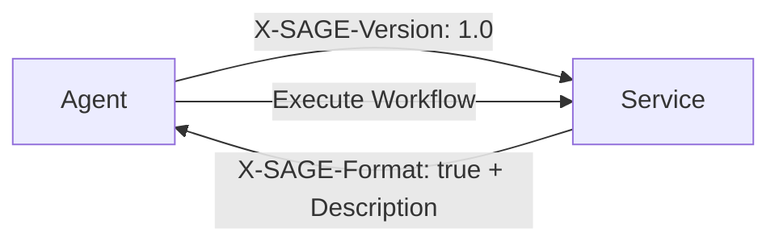

# SAGE Protocol

**Server-Agent Gateway Engine** — A service-facing interface description protocol for autonomous or semi-autonomous software agents.

[中文](README.zh-CN.md) · [Español](README.es.md) · [العربية](README.ar.md) · [Русский](README.ru.md)

---

## What is SAGE?

When a server detects that a request originates from an Agent, it can return a **SAGE Description Document** that describes available service workflows, login methods, parameter constraints, and execution boundaries. The Agent interprets the description, selects a workflow, requests user authorization where needed, and invokes existing service APIs.

SAGE does **not** replace HTTP, REST, GraphQL, OpenAPI, or MCP. It adds a **service-level workflow description layer** that makes existing services more usable by Agents.



## Key Features

- **Markdown-based** — Description Documents are human-readable Markdown
- **Incremental adoption** — Services add SAGE at the entry point, no API rewrite needed
- **Workflow-oriented** — Describes business processes, not just API endpoints
- **User authorization** — Explicit boundaries for sensitive operations
- **Privacy-first** — Per-service Agent keys, no cross-service tracking
- **Multi-language** — Description Documents work in any human language

## Repository Structure

```
sage-protocol/
├── README.md              # This file
├── README.zh-CN.md        # 中文文档
├── README.es.md           # Documentación en Español
├── README.ar.md           # التوثيق بالعربية
├── README.ru.md           # Документация на Русском
├── spec/
│   ├── sage-protocol-v1.0-draft-02-en.md  # Protocol specification (English)
│   └── sage-protocol-v1.0-draft-02-zh.md  # 协议规范（中文）
├── skill/
│   ├── sage-skill-v1.0.0-en.md            # Ready-to-use Skill (English)
│   ├── sage-skill-v1.0.0-zh.md            # 可直接使用的 Skill（中文）
│   ├── sage-skill-v1.0.0-es.md            # Skill listo para usar (Español)
│   ├── sage-skill-v1.0.0-ar.md            # مهارة جاهزة للاستخدام (العربية)
│   └── sage-skill-v1.0.0-ru.md            # Готовый к использованию навык (Русский)
└── LICENSE
```

## Quick Start

### For Service Providers

1. Read the [specification](spec/sage-protocol-v1.0-draft-02-en.md)
2. Detect `X-SAGE-Version` in incoming requests
3. Return a SAGE Description Document with `X-SAGE-Format: true` header
4. Your existing APIs stay unchanged

### For Agent Developers (Native Client)

1. Read the [specification](spec/sage-protocol-v1.0-draft-02-en.md)
2. Send `X-SAGE-Version` and `X-Agent-Public-Key` headers
3. Parse the returned Description Document
4. Execute workflows with user authorization

### For Agent Developers (Skill-based)

If your Agent Runtime doesn't have native SAGE support:

1. Copy the Skill file into your Agent's Skill/instruction mechanism:
   - [English](skill/sage-skill-v1.0.0-en.md) · [中文](skill/sage-skill-v1.0.0-zh.md) · [Español](skill/sage-skill-v1.0.0-es.md) · [العربية](skill/sage-skill-v1.0.0-ar.md) · [Русский](skill/sage-skill-v1.0.0-ru.md)
2. The Skill teaches your Agent how to discover, parse, and execute SAGE interactions
3. Works with any LLM-based Agent that supports tool calling or HTTP access

## Example: SAGE Description Document

```markdown
# Tokyo Hotel Booking Service

## General Notes
Login required: no
- All bookings require final user confirmation.

## Login Methods

## Budget-first Booking
Use this workflow when the user prioritizes price.

### Step 1
url: GET /hotels/search
params:
- city: string (required)
- sort: string (required, fixed=price)
- min_rating: float (optional, min=0, max=5, default=4.0)
prompt: Select three low-price hotels with acceptable ratings.

### Step 2
url: GET /hotels/availability
params:
- hotel_id: int (required)
- date: string (required, format=YYYY-MM-DD)
prompt: If unavailable, ask the user to adjust.

### Step 3
url: POST /bookings
params:
- hotel_id: int (required)
- check_in: string (required, format=YYYY-MM-DD)
- check_out: string (required, format=YYYY-MM-DD)
- guest_name: string (required)
prompt: Show summary and obtain explicit user confirmation before booking.
```

## How SAGE Relates to Other Protocols

| Protocol | Primary Unit | Question Answered |
|----------|-------------|-------------------|
| **OpenAPI** | API endpoint | What parameters does this endpoint accept? |
| **MCP** | Tool/resource | What callable tools are available to the Agent? |
| **SAGE** | Service workflow | How should an Agent use this service to complete a user task? |

## Specification Status

| Document | Version | Status |
|----------|---------|--------|
| [Protocol Spec (EN)](spec/sage-protocol-v1.0-draft-02-en.md) | v1.0 Draft 02 | Experimental |
| [协议规范 (ZH)](spec/sage-protocol-v1.0-draft-02-zh.md) | v1.0 Draft 02 | 实验性 |
| [Skill (EN)](skill/sage-skill-v1.0.0-en.md) | 1.0.0 | Ready-to-use |
| [Skill (ZH)](skill/sage-skill-v1.0.0-zh.md) | 1.0.0 | 可直接使用 |

## Conformance Levels

### SAGE Client

| Level | Requirements |
|-------|-------------|
| **Minimal** | Send `X-SAGE-Version`, detect `X-SAGE-Format`, parse headings, enforce user auth |
| **Standard** | + Parse all fields, validate params, token reuse, execution context |
| **Advanced** | + Cross-language parsing, audit logs, policy controls, explainability |

### SAGE Server

| Level | Requirements |
|-------|-------------|
| **Minimal** | Detect `X-SAGE-Version`, return `X-SAGE-Format`, valid Description Document |
| **Standard** | + Server version, token issuance, login methods, structured errors |
| **Advanced** | + Capability adaptation, token rotation, localized descriptions, dry-run |

## Contributing

This is an experimental specification. Feedback, issues, and pull requests are welcome.

1. Open an issue to discuss proposed changes
2. Submit pull requests against the spec or skill files
3. All contributions should follow the RFC 2119 requirement language convention

## Author

**段诗闻** (Shiwen Duan)  
Email: yakii9@vip.qq.com

## License

[CC BY 4.0](https://creativecommons.org/licenses/by/4.0/) — You are free to share and adapt this material, with attribution.
