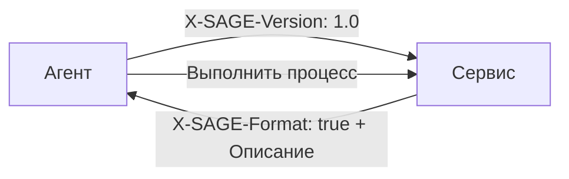

# Протокол SAGE

**Server-Agent Gateway Engine** — Сервисно-ориентированный протокол описания интерфейса для автономных или полуавтономных программных агентов.

[English](README.en.md) · [中文](README.md) · [Español](README.es.md) · [العربية](README.ar.md)

---

## Что такое SAGE?

Когда сервер обнаруживает, что запрос исходит от агента, он может вернуть **документ описания SAGE**, описывающий доступные рабочие процессы, методы входа, ограничения параметров и границы выполнения. Агент анализирует описание, выбирает рабочий процесс, запрашивает авторизацию пользователя при необходимости и вызывает существующие API сервиса.

SAGE **не заменяет** HTTP, REST, GraphQL, OpenAPI или MCP. Он добавляет **уровень описания рабочих процессов на стороне сервиса**, делающий существующие сервисы более удобными для использования агентами.



## Ключевые особенности

- **На основе Markdown** — Документы описания читаемы человеком
- **Инкрементальное внедрение** — Сервисы добавляют SAGE в точке входа, без переписывания API
- **Ориентация на рабочие процессы** — Описывает бизнес-процессы, а не просто API-эндпоинты
- **Авторизация пользователя** — Явные границы для чувствительных операций
- **Приватность прежде всего** — Отдельные ключи агента для каждого сервиса, без межсервисного отслеживания
- **Многоязычность** — Документы описания работают на любом языке

## Структура репозитория

```
sage-protocol/
├── README.md              # 中文（默认）
├── README.en.md           # English
├── README.es.md           # Español
├── README.ar.md           # العربية
├── README.ru.md           # Этот файл
├── spec/
│   ├── sage-protocol-v1.0-draft-02-en.md
│   ├── sage-protocol-v1.0-draft-02-zh.md
│   ├── sage-protocol-v1.0-draft-02-es.md
│   ├── sage-protocol-v1.0-draft-02-ar.md
│   └── sage-protocol-v1.0-draft-02-ru.md
├── skill/
│   ├── sage-skill-v1.0.0-en.md     # Skill (English)
│   ├── sage-skill-v1.0.0-zh.md     # Skill (中文)
│   ├── sage-skill-v1.0.0-es.md     # Skill (Español)
│   ├── sage-skill-v1.0.0-ar.md     # Skill (العربية)
│   └── sage-skill-v1.0.0-ru.md     # Skill (Русский)
└── LICENSE
```

## Быстрый старт

### Для поставщиков сервисов

1. Прочитайте [спецификацию](spec/sage-protocol-v1.0-draft-02-ru.md)
2. Обнаруживайте `X-SAGE-Version` во входящих запросах
3. Возвращайте документ описания SAGE с заголовком `X-SAGE-Format: true`
4. Ваши существующие API остаются без изменений

### Для разработчиков агентов (нативный клиент)

1. Прочитайте [спецификацию](spec/sage-protocol-v1.0-draft-02-ru.md)
2. Отправляйте заголовки `X-SAGE-Version` и `X-Agent-Public-Key`
3. Анализируйте возвращённый документ описания
4. Выполняйте рабочие процессы с авторизацией пользователя

### Для разработчиков агентов (на основе навыка)

Если ваша среда выполнения агента не поддерживает SAGE нативно:

1. Скопируйте файл [навыка](skill/sage-skill-v1.0.0-ru.md) в механизм навыков/инструкций вашего агента
2. Навык обучает вашего агента обнаруживать, анализировать и выполнять взаимодействия SAGE
3. Работает с любым LLM-агентом, поддерживающим вызов инструментов или HTTP-доступ

## Пример: Документ описания SAGE

```markdown
# Сервис бронирования отелей в Токио

## Общие примечания
Требуется ли вход в систему: нет
- Все бронирования требуют окончательного подтверждения пользователя.

## Методы входа

## Бронирование с приоритетом бюджета
Используйте этот процесс, когда пользователь приоритизирует цену.

### Шаг 1
url: GET /hotels/search
params:
- city: string (required)
- sort: string (required, fixed=price)
- min_rating: float (optional, min=0, max=5, default=4.0)
prompt: Выберите три недорогих отеля с приемлемыми рейтингами.

### Шаг 2
url: GET /hotels/availability
params:
- hotel_id: int (required)
- date: string (required, format=YYYY-MM-DD)
prompt: Если недоступно, попросите пользователя скорректировать.

### Шаг 3
url: POST /bookings
params:
- hotel_id: int (required)
- check_in: string (required, format=YYYY-MM-DD)
- check_out: string (required, format=YYYY-MM-DD)
- guest_name: string (required)
prompt: Покажите сводку и получите явное подтверждение пользователя перед бронированием.
```

## Отношение к другим протоколам

| Протокол | Основная единица | Отвечаемый вопрос |
|----------|-----------------|-------------------|
| **OpenAPI** | API-эндпоинт | Какие параметры принимает этот эндпоинт? |
| **MCP** | Инструмент/ресурс | Какие инструменты доступны агенту? |
| **SAGE** | Рабочий процесс сервиса | Как агент должен использовать этот сервис для выполнения задачи пользователя? |

## Уровни соответствия

### Клиент SAGE

| Уровень | Требования |
|---------|-----------|
| **Минимальный** | Отправка `X-SAGE-Version`, обнаружение `X-SAGE-Format`, анализ заголовков, принудительная авторизация пользователя |
| **Стандартный** | + Анализ всех полей, валидация параметров, повторное использование токенов, контекст выполнения |
| **Продвинутый** | + Многоязычный анализ, журналы аудита, политики контроля, объяснимость |

### Сервер SAGE

| Уровень | Требования |
|---------|-----------|
| **Минимальный** | Обнаружение `X-SAGE-Version`, возврат `X-SAGE-Format`, действительный документ описания |
| **Стандартный** | + Версия сервера, выпуск токенов, методы входа, структурированные ошибки |
| **Продвинутый** | + Адаптация возможностей, ротация токенов, локализованные описания, пробный запуск |

## Участие в проекте

Это экспериментальная спецификация. Приветствуются отзывы, issues и pull requests.

## Автор

**段诗闻** (Shiwen Duan)  
Email: yakii9@vip.qq.com

## Лицензия

[CC BY 4.0](https://creativecommons.org/licenses/by/4.0/) — Вы свободны делиться и адаптировать этот материал с указанием авторства.
