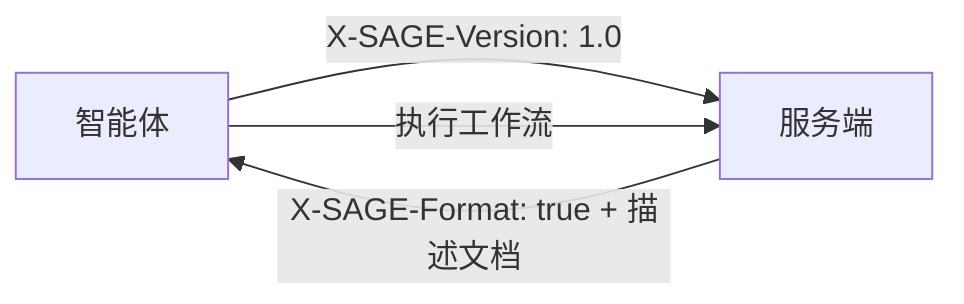

# SAGE 协议

**服务端-智能体网关引擎（Server-Agent Gateway Engine）** — 面向自主或半自主软件智能体的服务端接口描述协议。

[English](README.md)

---

## 什么是 SAGE？

当服务端检测到请求来自智能体时，它可以返回一份 **SAGE 描述文档**，描述可用的服务工作流、登录方法、参数约束和执行边界。智能体解读描述文档，选择工作流，在必要时请求用户授权，并调用已有的服务 API。

SAGE **不替代** HTTP、REST、GraphQL、OpenAPI 或 MCP。它增加了一个**服务级工作流描述层**，使现有服务更易于被智能体使用。



## 核心特性

- **基于 Markdown** — 描述文档是人类可读的 Markdown
- **增量采纳** — 服务在入口点添加 SAGE，无需重写 API
- **工作流导向** — 描述业务流程，而非仅仅是 API 端点
- **用户授权** — 敏感操作有明确的授权边界
- **隐私优先** — 每个服务独立的智能体密钥，无跨服务追踪
- **多语言** — 描述文档可用任何人类语言编写

## 仓库结构

```
sage-protocol/
├── README.md                              # 英文文档
├── README.zh-CN.md                        # 本文件
├── spec/
│   ├── sage-protocol-v1.0-draft-02-en.md  # 协议规范（English）
│   └── sage-protocol-v1.0-draft-02-zh.md  # 协议规范（中文）
├── skill/
│   ├── sage-skill-v1.0.0-en.md            # 可直接使用的 Skill（English）
│   └── sage-skill-v1.0.0-zh.md            # 可直接使用的 Skill（中文）
└── LICENSE
```

## 快速开始

### 服务提供商

1. 阅读[协议规范](spec/sage-protocol-v1.0-draft-02-zh.md)
2. 检测入站请求中的 `X-SAGE-Version`
3. 返回带 `X-SAGE-Format: true` 头部的 SAGE 描述文档
4. 现有 API 保持不变

### 智能体开发者（原生客户端）

1. 阅读[协议规范](spec/sage-protocol-v1.0-draft-02-zh.md)
2. 发送 `X-SAGE-Version` 和 `X-Agent-Public-Key` 头部
3. 解析返回的描述文档
4. 在用户授权下执行工作流

### 智能体开发者（基于 Skill）

如果你的智能体运行时没有原生 SAGE 支持：

1. 将 [Skill 文件](skill/sage-skill-v1.0.0-zh.md) 复制到你的智能体的 Skill/指令集机制中
2. Skill 会教会你的智能体如何发现、解析和执行 SAGE 交互
3. 适用于任何支持工具调用或 HTTP 访问的基于 LLM 的智能体

## 示例：SAGE 描述文档

```markdown
# 东京酒店预订服务

## 一般注意事项
是否需要登录：否
- 所有预订需要最终用户确认。

## 登录方法

## 预算优先预订
当用户优先考虑价格时使用此工作流。

### 步骤 1
url: GET /hotels/search
params:
- city: string (required)
- sort: string (required, fixed=price)
- min_rating: float (optional, min=0, max=5, default=4.0)
prompt: 选择三个价格低且评分可接受的酒店。

### 步骤 2
url: GET /hotels/availability
params:
- hotel_id: int (required)
- date: string (required, format=YYYY-MM-DD)
prompt: 如果不可用，请用户调整。

### 步骤 3
url: POST /bookings
params:
- hotel_id: int (required)
- check_in: string (required, format=YYYY-MM-DD)
- check_out: string (required, format=YYYY-MM-DD)
- guest_name: string (required)
prompt: 展示摘要并在预订前获得用户明确确认。
```

## SAGE 与其他协议的关系

| 协议 | 主要单元 | 回答的问题 |
|------|---------|-----------|
| **OpenAPI** | API 端点 | 该端点接受哪些参数？ |
| **MCP** | 工具/资源 | 智能体可以调用哪些工具？ |
| **SAGE** | 服务工作流 | 智能体应如何使用此服务完成用户任务？ |

## 规范状态

| 文档 | 版本 | 状态 |
|------|------|------|
| [Protocol Spec (EN)](spec/sage-protocol-v1.0-draft-02-en.md) | v1.0 Draft 02 | Experimental |
| [协议规范 (ZH)](spec/sage-protocol-v1.0-draft-02-zh.md) | v1.0 Draft 02 | 实验性 |
| [Skill (EN)](skill/sage-skill-v1.0.0-en.md) | 1.0.0 | Ready-to-use |
| [Skill (ZH)](skill/sage-skill-v1.0.0-zh.md) | 1.0.0 | 可直接使用 |

## 一致性级别

### SAGE 客户端

| 级别 | 要求 |
|------|------|
| **最小** | 发送 `X-SAGE-Version`，检测 `X-SAGE-Format`，解析标题，强制用户授权 |
| **标准** | + 解析所有字段，验证参数，令牌重用，执行上下文 |
| **高级** | + 跨语言解析，审计日志，策略控制，可解释性 |

### SAGE 服务端

| 级别 | 要求 |
|------|------|
| **最小** | 检测 `X-SAGE-Version`，返回 `X-SAGE-Format`，合法描述文档 |
| **标准** | + 服务端版本，令牌颁发，登录方法，结构化错误 |
| **高级** | + 能力适配，令牌轮换，本地化描述，试运行 |

## 参与贡献

这是一份实验性规范。欢迎反馈、Issue 和 Pull Request。

1. 开启 Issue 讨论拟议变更
2. 提交针对规范或 Skill 文件的 Pull Request
3. 所有贡献应遵循 RFC 2119 需求语言惯例

## 作者

**段诗闻** (Shiwen Duan)  
邮箱：yakii9@vip.qq.com

## 许可证

[CC BY 4.0](https://creativecommons.org/licenses/by/4.0/) — 你可以自由分享和改编本材料，但需注明出处。
